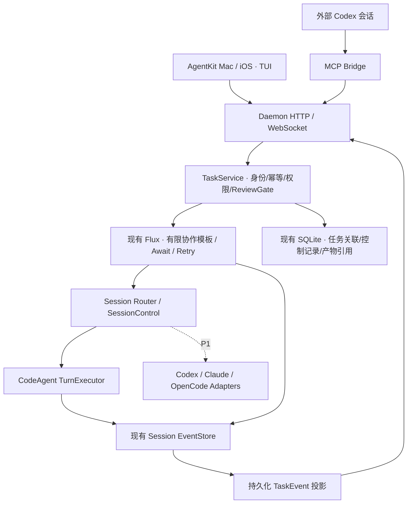

# AI Coding Workspace：P0 / P0.5 架构设计

日期：2026-10-27。状态：设计提案，未实现。承接 [跨 Agent 调研](cross-agent-collaboration-research.md)，将 AgentKit 的定位调整为完整协作工作区。以下新增类型、工具、端点、文件和 capability 均是拟议名称。

范围更新：P0-A 已按 [Agent 独立性边界](p0a-agent-boundaries.md) 冻结；下一批以 [P0-B 最小 Task/Session 契约](p0b-task-session-contract.md) 为准。本文保留完整目标，不能当作第一批实施清单。新的 Participation 关联允许 Session 跨任务复用，并以 external SessionRef 表达 reported 外部会话，取代本文第 4 节的初期限单任务/observed 本地会话方案。

## 1. 决策摘要

Daemon 管理任务关联、派发、审查门禁、恢复和审计；AgentKit / TUI 管理交互；每个 Agent 保留自己的推理与执行上下文。复用现有会话仓库、TurnExecutor、SessionControl、事件持久化及 Flux，不新增独立 Supervisor 服务。

- P0 就持久化 Task、参与关系、计划、审查、产物和控制命令；P0.5 增加聚合 Timeline，而不是届时再改变数据归属。
- Task 是跨会话的开发目标；Session 是某个 Agent 的连续上下文；Flux Task 是工作流引擎内部执行实例。三者不能共用 ID 或生命周期。
- P0：Codex 经 MCP 提交计划、领取执行结果、提交审查；CodeAgent 是唯一受管的工作区写入者。
- 外部 Codex 仅提供它明确回报的数据。MCP 不会自动暴露调用端的所有工具事件或原生会话 ID；P0 显示“外部回报”，P1 Adapter 才提供更完整的执行轨迹。
- 只有一处调度权：任务工作流由 Flux 驱动。TaskService 是领域入口和控制门禁，不再实现另一套调度循环。
- 单 Agent 模式保留原行为；未来 Codex 单独模式和 Collaborative Mode 共用任务协议，但前者的执行适配属于 P1。

## 2. 源码核对与实际复用点

| 范围 | 实际源码 | 当前能力 / 限制 |
|---|---|---|
| 会话服务 | `internal/conversation/repository.go`、`sqlite_repository.go`、`executor.go` | 当前核心是 Repository + TurnExecutor + TransportSession，并非一个可直接扩展的 ConversationManager 类 |
| 会话路由 | `internal/controlplane/owner.go`、`control.go`、`target.go` | owner lease、目标会话执行、跨进程路由；当前 Target 默认执行 CodeAgent |
| 持久化入站 | `internal/session/turn_input.go`、`sqlite/turn_input.go` | `(session_id, request_id)` 去重、payload hash、turn 状态及 cross-session provenance |
| 会话事件 | `internal/conversation/eventstore.go`、`subscription.go`、`executor.go` | seq 来自具体 store 的自增行号；跨 store 不可比较；瞬态 delta 不持久化；慢消费者可能丢实时通知 |
| 工作流 | `internal/runtime/flux_cross_workspace.go`、`flux_tool.go`、`flux_resolver.go`、`headless.go` | v2 为单轮实现/审查；Await、条件分支、恢复入口可复用；重启后需重建工具投影和 resolver |
| 工作流存储 | `newFluxRuntime`、`go.mod` | 当前模板实际使用 `flux-workflow v1.0.7` 的 `.codeagent/flux-workflows/flux-workflows.db`，不能误用 `internal/fluxstore` 的另一套旧 Flux 表作为当前引擎状态 |
| 产物 | `internal/server/asset_api.go` | 从 tool_finished 的 Assets 查预览/内容；部分内容读取当前文件，不是不可变审查快照 |
| 审批 | `internal/server/approver.go` | 多设备广播、断线重发；pending 请求和等待 channel 主要在内存，不能直接承诺跨 daemon 重启恢复原审批 |
| AgentKit 依赖 | `../chater/Talkify.xcodeproj/project.pbxproj` | 引用本地包 `../AgentKit`，核心 UI/协议改动应落在该包 |
| 多会话 UI | `../AgentKit/.../ConversationSupervisor.swift`、`Core/RuntimeSessionChannel.swift` | 持有多个会话控制器；每条 channel 绑定 session；选择变化是展示行为 |
| Timeline | `Core/RuntimeEngine/RuntimeEngine.swift`、`TimelineProjection.swift`、`Features/Conversation/Views/TurnTimelineView.swift`、`TurnView.swift` | 单会话 ExecutionGraph → ConversationTurn → TurnBlock；不能把多会话事件直接输入同一个 reducer |
| Work Product | `Core/Artifact/ArtifactNode.swift`、`ArtifactGraph.swift` | 现有 artifact 身份为 callID，聚合后需要来源限定；当前无名为 WorkProductCard 的独立组件 |
| 审批 UI | `Features/Conversation/Components/PlanApprovalBar.swift` | 包含 PlanApprovalBar 和 ApprovalBar；当前绑定具体会话 ViewModel 的回调 |
| 宿主 | `../chater/Talkify/AppContainer.swift`、`CodeAgentDaemon.swift`、`TalkifyIOS/ChatViewController.swift`、`WorkspaceHubView.swift` | daemon 连接、服务注入、iOS 导航与 Workspace 入口；不应在此实现各家 CLI 调度 |
| TUI | `cmd/codeagent/tui/backend.go`、`sessions.go` | 当前主要是本地 Runner 的 channel backend；还不是可直接复用的 daemon task 客户端 |

表中 `../AgentKit/...` 为包内路径缩写。用户所称 TurnCard 对应当前 TurnView / ConversationTurn，设计和改动清单按实际名称描述。

## 3. 分层与唯一调度权



Bridge 只做协议转换和已绑定 runtime 的认证连接，不开第二个 CodeAgent Runner。首版建议 stdio MCP sidecar 调用 daemon 的领域 HTTP API；与未来 Adapter 共用 TaskService。daemon 的随机 token、端口和 server_id 通过显式本地连接配置提供；配置失效须重新绑定，不能硬编码端口或把 token 作为工具结果交给模型。

API 可以查询、提交领域命令；Flux 决定下一阶段何时运行；SessionControl 决定 turn 由哪个 owner 执行；TurnExecutor 决定工具能否执行。任何“已接受”仅指该层真实完成了持久化 admission，不等于工作完成。

## 4. 数据契约：Task / Session / Participation / Attempt

| 对象 | P0 必需字段 | 约束 |
|---|---|---|
| CodingTask | `task_id`、`server_id`、workspace_ref、mode、goal、acceptance、state、phase、revision、max_iterations、current_iteration、plan_revision、workflow_ref | task_id 使用 `ctask_...` 字符串；workflow_ref 包含实际 workspace、workflow_id、Flux task ID 字符串 |
| Session | 既有 ID、workspace、metadata；新增可查询 runtime_kind、session_kind、external_session_id? | 本地会话仍由既有仓库维护；外部 native ID 可缺省，不能从 clientInfo 或模型文字推断 |
| TaskParticipation | task_id、session_id、agent_id、role、participation_id、parent_participation_id?、capabilities、observation_level | role 属于参与关系；同一 Codex session 可有 planner/reviewer 两个参与关系，不覆盖历史角色 |
| TaskAttempt | attempt_id、task_id、stage、iteration、participation_id、session_id、turn_id?、request_id、artifact_version?、status、workflow_node | 明确绑定每轮/每个 turn；审查不能使用“会话最后一条消息”代替特定轮次输出 |
| TaskArtifact | artifact_id、kind、task_id、attempt_id、version、producer、content_hash、snapshot_ref、source_ref、size、truncated | plan / patch / test_report / review 均为可寻址产物；review 绑定被审查的 artifact hash |
| TaskCommand | command_id、request_id、actor、payload_hash、expected_revision、control_epoch、status、result_ref | 幂等去重并审计；相同 key 不同 payload 返回冲突 |

P0 限制每个参与 Session 只归属一个协作 Task，避免同一原生上下文同时服务互不相关任务；一个 Task 可有多个 session。以后若允许复用，必须依赖 participation/attempt 的 turn 范围，不能只靠 session.task_id。

task_id、agent_id、role 可通过会话 DTO 暴露，但权威关联存在 TaskParticipation。不要仅写入可随完整 Session.Save 被覆盖的 metadata。`parent_session_id` 继续表示真实 spawn/fork 因果；父任务不是伪造的父会话，业务层级使用 task_id / parent_participation_id。

P0 外部 Codex 使用同一会话仓库的轻量 observed Session：不保存虚构的推理消息，不注入本地系统 prompt，不绑定本地 TurnExecutor、不取得执行 lease。仅保存来源标记和明确回报的计划/审查。需要新增显式创建/类型检查端口；现有 create_session 的父会话 owner 校验不能通过伪造在线父会话绕过。P1 managed external Session 才声明可派发/取消等能力。

agent_id 是 daemon 授予的 Agent 实例身份；runtime_kind 是 codex / codeagent / claude / opencode；model 是该实例使用的模型。角色由任务配置授予，MCP 客户端声称“我是 reviewer”本身不构成完成任务的授权。

### 存储边界

P0 在 `Assemble` 既有 session SQLite store 内增加 `coding_tasks`、`task_participations`、`task_attempts`、`task_artifacts`、`task_commands` 及投影 checkpoint。扩展 optional store port，避免迫使所有第三方 store 实现新能力；无该 port 不宣告协作 capability。不引入新的数据库服务。

TaskEvent 复用现有 `session_events` 的持久化实现，以保留命名空间的 `task:<task_id>` 作为内部流分区 key；它不是 Conversation，不进入会话列表、不由 TurnExecutor 执行。对外字段为 task_id / task_seq，不暴露内部复用方式。任务数据和任务事件通过新增窄事务端口一起提交；不能在 HTTP handler 里先 Save Task 再独立 Append，留下断裂状态。

Flux 数据库与 session SQLite 当前分开，不能声称跨库原子提交。TaskCommand 作为 durable outbox，持久化待提交的工作流请求和稳定关联 key；恢复时核对已提交 run 后再派发。若 Flux 现有 Submit 无法以该 key 去重/查询，需要最小持久化适配；在此落实前不宣称工作流提交 exactly-once。用户业务层只读取 Task 投影，不把 Flux 的 succeeded 等同为开发任务通过审查。

## 5. 统一 TaskEvent 与事件来源

```json
{
  "schema_version": 1,
  "task_id": "ctask_example",
  "task_seq": "42",
  "event_id": "cte_example",
  "kind": "review.submitted",
  "recorded_at": "2026-10-27T09:00:00Z",
  "agent_id": "agent_codex_example",
  "participation_id": "part_reviewer",
  "role": "reviewer",
  "attempt_id": "attempt_review_1",
  "session_id": "session_observed_example",
  "turn_id": null,
  "iteration": 1,
  "control_epoch": "3",
  "artifact_refs": ["artifact_review_example"],
  "source": {"kind": "mcp_report", "request_id": "req_example"},
  "payload": {"verdict": "request_changes", "reviewed_artifact_id": "artifact_patch_1"}
}
```

示例是协议示意，不是真实任务。seq/revision/大整数 ID 对外统一为十进制字符串，避免 Web/JS 精度问题；Swift/Go 内部可使用 Int64。

事件词汇至少包含：task.created、participant.attached、plan.submitted/approved、attempt.dispatched/started/completed/failed、artifact.published、review.requested/submitted、rework.requested、approval.requested/resolved/invalidated、user.commanded、task.paused/resumed/completed/failed/cancelled。stage/role/iteration 都是结构字段，不能从消息正文解析。

两层流并存：Task 流保存协作里程碑、状态与可下钻的来源引用；Session 流保存该 Agent 的细节。对工具调用，TaskEvent 可发 `session.event_linked` 摘要，携带 source server/store/session/seq、call_id 和 kind；完整参数、日志和 token 仍在 Session 流。P0.5 默认折叠工具事件，按需打开原 Session Timeline，避免复制所有 delta。

| 来源 | 可记录内容 | 不可声称的内容 |
|---|---|---|
| CodeAgent TurnExecutor | 实际生命周期、工具、产物、测试执行证据 | 仅凭总结证明测试通过 |
| 外部 Codex + MCP | 已提交计划、委派请求、收到结果、提交的审查 | Codex 所有工具调用、隐藏推理、客户端完整历史 |
| P1 native Adapter | 对应协议真正暴露的事件、审批和生命周期 | provider 未公开的事件或不支持的动作 |
| 用户 | 显式命令、审批、人工修改说明、重新检查结果 | 未发生的自动执行 |

observation_level 可取 `reported` / `managed`，artifact 标记 `reported` / `runtime_captured`。UI 显示数据来源，未知费用/测试数量不伪造为 0。

### 顺序、投影和断线恢复

Task 流由 daemon 单一持久化排序，不能按各设备时间或 MAX(child.seq) 合并。task_seq 只在此 task stream 所属 store 内有效、有空洞；Session cursor、Task cursor、Flux event cursor 互不混用。

受管会话的投影读取已提交事件，按 `(source_server_id, source_store_id, session_id, seq, projection_kind)` 去重。Projector checkpoint 与投影事件在同一事务提交。跨 store 用稳定 store identity，不能用会变化的绝对文件路径作为唯一身份。实时 SubscriptionManager 仅负责唤醒，不能当可靠消息源；重启和周期扫描必须补齐漏掉的里程碑。

Task snapshot 包含 `snapshot_task_seq`、状态、参与关系、当前 attempt、产物、待处理审批/命令；状态与 cursor 从同一一致性读取获得。客户端订阅 `after=snapshot_task_seq`，服务端在捕获水位后补 backlog 再接直播，去重并检测缺口。慢消费者溢出后明确要求 catch-up，而不是继续显示一个看似完整的状态。

## 6. P0 的 MCP 与 HTTP 契约

保留五个基础工具：

| MCP 工具 | 领域行为 |
|---|---|
| codeagent_create_session | 创建本地会话；task-scoped 请求需已有 Task 及授权参与关系 |
| codeagent_send_to_session | 独立会话沿用 SessionControl；协作会话只接受工作流授权的 attempt，不能绕过计划门禁任意起 turn |
| codeagent_wait_sessions | 等待具体 session + turn + cursor；短超时返回 waiting，不取消后台工作 |
| codeagent_read_session | 读取具体会话/指定 attempt 或 turn；observed Session 只显示已回报内容 |
| codeagent_get_artifacts | 按 task / attempt / version 获取不可变产物及其授权下载引用 |

五个会话工具不足以闭环。P0 还应提供 `codeagent_create_task`、`codeagent_read_task`、`codeagent_submit_plan`、`codeagent_submit_review`，明确保存外部 planner/reviewer 的输入并支持恢复查询。创建 Task 返回 TaskRef、observed Session 及 executor Session 的稳定引用，创建由 TaskService 统一办理；每个 mutation 都要求 request_id。read_task 返回当前执行回执、应审查产物和可用动作，恢复后的 Codex 不需要猜测当前轮次。

Collaborative Mode 的推荐路径是 create_task → submit_plan →（按用户策略批准计划）→ Flux 派发执行 → wait/read/artifacts → submit_review。Codex 不再同时通过普通 send 手工派发相同执行任务；受管 session 的自由 send 返回明确 task_managed_session 错误和允许的任务动作。会话工具仍可用于单 Agent 和非受管场景。

| 拟议 daemon API | 用途 |
|---|---|
| POST /v1/tasks | 幂等创建 Task 和关联会话 |
| GET /v1/tasks?workspace_ref=... | 任务列表；使用稳定 workspace 引用，跨设备不拿本机路径拼接 |
| GET /v1/tasks/{id} | 一致性 snapshot、可用动作与 capability |
| GET /v1/tasks/{id}/events?after=... | 增量 TaskEvent |
| GET /v1/tasks/{id}/stream?after=... | 只读 WebSocket：backlog + live |
| POST /v1/tasks/{id}/plans | planner 提交版本化计划和验收条件 |
| POST /v1/tasks/{id}/reviews | reviewer 提交绑定产物的结构化 verdict |
| GET /v1/tasks/{id}/artifacts | 产物目录、版本、来源及内容引用 |
| POST /v1/tasks/{id}/commands | 用户的 approve_plan / pause / resume / cancel / request_rework / take_over |

MCP 与后续 Adapter 均调用这些领域服务，HTTP 只是其中一个 facade。外部事件导入采用受信 Adapter 内部入口，不开放一个允许模型任意伪造 task.completed 的通用 emit_event 工具。

Task WS 保持只读，不能像普通会话连接那样取得审批控制权；会话详情仍用现有 /conversations API。新增 capability `collaboration_tasks_v1`、`task_event_stream_v1`、`task_artifacts_v1`、`task_controls_v1`，并区分 reported/managed agent 能力。旧客户端继续使用现有会话；不能仅增加未知 kind 后期待旧 AgentEvent 解码器自动渲染 Task UI。

Task、Session、产物和订阅采用同一授权范围。plan/review 回报权不包含用户审批权；跨 workspace 或 server 的会话关联须显式验证。外部 clientInfo 只用于客户端标识，不用于授予 Task 访问权。

## 7. 审查 Gate 与现有 v2 的复用

ReviewGate 是一个纯领域校验/决策组件，由 submit_review 和工作流 review_gate 节点共用：检查 reviewer 权限、attempt、plan_revision、artifact hash、控制 epoch，以及结构化 verdict。`pass`、`request_changes`、`inconclusive` 三种结果必须区分；无效或缺失 verdict 不能默认为通过。

当前 v2 有三个额外缺口：读取的是 `read_session.last_turn`，可能串入后续 turn；`dispatch_review` 不自动携带 read_impl 的实际产物；REQUEST_CHANGES 不影响后继执行。新模板必须传入确切 attempt 输出、测试证据、snapshot hash 和 acceptance。

建议保留已有 v2 定义，新增版本化模板 `coding_collaboration_v1`，复用原 dispatch / await / read 工具节点与 parent Map 结构；避免给历史运行定义原地换语义。P0 仅一个 Executor，Map 并行度为 1；P1 再开放多独立 worktree。

```text
plan_ready → plan_gate
  → implement_1 → await_impl_1 → capture_1 → request_review_1 → await_review_1 → review_gate_1
      pass            → completion_gate
      request_changes → implement_2 → ... → review_gate_2
      inconclusive    → await_user
  → completion_gate：当前产物仍匹配 + 验收证据满足 + 未暂停/取消 → Task completed
```

max_iterations 定义为实现—审查总轮数，初次为 1；值 2 表示初次加一次返工。将有限轮次展开为独立 DAG 节点并以 EdgeCondition 路由，保留每轮历史，不加普通回边，不用 Retry 充当业务返工。已核对本地缓存的固定依赖 v1.0.7 有条件边执行逻辑；尽管存在 NodeLoop 类型，未验证其满足此场景，设计不依赖它。

request_changes 表示审查调用成功但业务未验收；只有到门禁判定才能派发下一轮。次数耗尽转 waiting / review_budget_exhausted 让用户处理；基础设施失败走现有失败恢复路径。Retry 仅重试未完成/失败节点，不隐式重跑已完成的实现轮次。

P0 外部 review 通过 submit_review 的持久化结果满足 Await；现有 externalResolver 只认识 session/turn，需要增加按 await provider kind 分流的 review resolver，不能构造假 turn_finished 让它通过。P1 managed reviewer 使用真实 SessionControl/Adapter turn，同一 ReviewGate 和结果格式不变。

P0 计划、审查外部执行由 Codex 自身会话推进，Daemon 不能在它消失后自动重启该客户端。停在 waiting_external，保存应审查的产物，用户恢复外部会话或重新绑定 reviewer 后继续。P1 托管 Adapter 才能按能力主动请求下一轮。

同一外部 Codex 会话同时担任 planner/reviewer 在 P0 可以支持，但 UI 应标记为同一上下文；这不等于现有 v2 所说的独立 reviewer session。需要独立审查时绑定第二个真实外部会话，P1 可由 Adapter 管理其创建。

## 8. 状态、恢复和人工干预

Task `state`：active / waiting / paused / completed / failed / cancelled；`phase`：planning / implementing / reviewing / reworking / finalizing。等待原因独立保存：plan_approval、tool_approval、external_review、external_offline、review_budget_exhausted、recovery_required。不能用最后一条 Session 的成功状态覆盖 Task。

| 情况 | 必须采取的行为 |
|---|---|
| Bridge 断开 / wait 超时 | 已受理执行继续；重连读取 durable Task；不重复派发 |
| daemon 重启 | 初始化 TaskService，恢复工作流工具与 resolver，核对 Command/outbox、TurnInput、源事件水位与 Flux run，再恢复符合条件的等待 |
| 工作已做但尚未记完成 | 先查 admission、terminal 和产物；结果不确定转 recovery_required，不盲目重复有副作用的工作 |
| 外部 planner/reviewer 消失 | waiting_external，已有结果保留，等待恢复或用户重新绑定 |
| pause | 先持久化 fence，禁止新阶段/新写入 admission；当前工具到安全边界停下；pausing 期间不能宣称写入已停止 |
| cancel | 先封禁后续调度，再取消当前/排队 turn；确认停止后记录取消结果，不自动删除 worktree 或回滚改动 |
| take_over | pause、等待执行器停写、交给用户；人工改动后生成新 artifact version 并重新审查，旧 PASS 失效 |
| Mac / iOS 同时批准 | command_id 去重 + expected_revision / control_epoch；只有第一条有效决定生效，后续返回已处理/冲突 |

人机控制命令保存 actor 和预期版本。暂停、取消、重新绑定或人工修改推进 control_epoch；外部晚到的 plan/review 可以审计保存，但不驱动当前任务。实现应区分暂停请求和停止确认，无法立即终止的命令在 UI 中保留 stopping 状态。

修改已批准计划必须先停下当前执行，递增 plan_revision 并重新批准；保留 Task 身份，保存新的 workflow_ref/运行历史，不原地修改正在运行的 DAG。snapshot 单独携带 pending_control_command / control_status，不能把已请求暂停直接显示为已暂停。

Review、tool permission、plan approval 是不同门禁。现有 RemoteApprover 可继续负责进程内阻塞及多设备广播，但跨重启恢复要增加 durable pending/resolution 记录：重建时核对 attempt，已失效请求标记 invalidated，必要时重新询问，不复用旧授权执行新的参数。P0 不以审批永久自动放行来解决无人在线问题。

Task 的审批摘要引用 `(server_id, session_id, turn_id, approval_id)`。实际会话工具审批仍通过绑定 session 的控制 channel；Task 计划批准通过任务命令。Task 观察流不持有审批 sink，Bridge 不应悄悄自动回答用户审批。

## 9. 产物与单写入者约束

第一版为任务提供专用 managed worktree。计划/审查阶段不给受管外部 Agent 写权限；CodeAgent 同时最多一个执行 attempt。Daemon 对受管任务的 canonical workspace 施加写入 admission/fence，所有入口都必须检查，不能只在 UI 禁用按钮。

这不能阻止用户编辑器或独立启动的外部 CLI 写文件。P0 对非托管 Codex 的只读行为属于调用配置/操作约定，Daemon 只能约束自己派发的执行；计划/审查前后检测 snapshot 变化，发生变化即使审查返回 PASS 也不可完成。P1 受管 Adapter 通过 runtime sandbox/工具能力真正施加只读限制。

capture 节点冻结 patch、源文件审查快照、测试报告，记录基线、diff hash、涉及文件内容 hash，处理未跟踪文件、删除、重命名和文件模式。审查默认读取 frozen version，而不是现有 asset API 动态读取的当前路径。产物可复用现有 assets/Inspector 展示，但要新增不可变内容引用和版本查询。

测试报告保存命令、退出码、执行 attempt、日志引用及截断标记；区分 runtime_captured 与外部自报。测试必须对应被审查的版本；review 通过后工作区改变会让 completion_gate 重新等待。不会因为一条消息写着“测试通过”就标绿。

artifact 在任务级有独立 artifact_id；原有 source_asset_id / callID 保留在 source_ref。跨 session 聚合使用带 server/session/turn/call 限定的来源 key，不修改原单会话 ArtifactGraph 的身份规则。

## 10. AgentKit / chater / TUI 的适配

增加 `TaskStore / TaskTimelineProjection / TaskViewModel`：TaskEvent → TaskSnapshot → TaskTimelineItem。它们是任务投影，不向现有单会话 ExecutionReducer 注入混合事件。父卡片点击后由 ConversationSupervisor 获取既有 Session controller；返回父任务保留滚动和展开状态。

| 当前组件 | P0 | P0.5 |
|---|---|---|
| WorkspaceStore / Navigation | 原会话入口，显示关联 task 摘要及等待原因 | 新增 taskDetail 选择态和父任务入口；单 Agent 原入口保留 |
| TurnTimelineView / TurnView | 继续展示 CodeAgent 具体会话 | 子会话页复用；父任务使用 TaskTimelineItem，显示 Agent 身份、角色、轮次、来源和状态 |
| ArtifactNode / ArtifactView / DiffInspector | 可打开冻结 patch 与计划/审查内容 | 任务产物目录、版本选择、review finding 对应 snapshot 的文件行导航 |
| PlanApprovalBar / ApprovalBar | 执行会话审批照旧；任务计划由任务命令确认 | Task 层聚合请求；回调路由到明确 owner，不能发送到当前选中会话 |
| ConversationSupervisor | 复用会话持有与状态发现 | 聚合全部 pending 请求，避免当前每会话只取首个的摘要遗漏队列；按需保留子会话控制器 |
| Native / Web Timeline | 原会话渲染不改 | Task 页面先共用 SwiftUI 语义模型；现有 Native 与 Web 子会话页都需验证，不能只改一个 renderer |
| chater Mac / iOS | daemon 认证、连接与 capabilities 注入 | iOS UIKit/SwiftUI 包装器和 WorkspaceHub 增加父任务路由；共享模型、不同导航布局 |
| TUI | 原本地单会话执行保持 | 增加明确连接 daemon 的任务客户端入口：任务列表、里程碑、子会话定位及 pause/cancel/approval；不另起执行副本 |

建议的父任务界面：顶部 goal、phase、迭代、可用控制；下方按 task_seq 的 Planner / Executor / Reviewer 卡片；右侧或 iOS sheet 打开计划、冻结 Diff、测试证据和 findings。reported Codex 卡片只显示已提交内容，入口写明“外部会话”，不提供不存在的实时工具轨迹。

“用户干预”在 P0 已有后端命令与停写语义，P0.5 提供完整父任务交互；P2 的动态角色切换属于扩展，不能把基础 pause/cancel 全部推迟到 P2。

## 11. 改动范围与交付边界

| 位置 | P0 计划改动 | P0.5 计划改动 |
|---|---|---|
| 新 `internal/collab/` | 类型、TaskService、ReviewGate、commands、参与/attempt/产物、可靠投影及恢复；无 LLM 调度循环 | task 列表和视图查询优化 |
| `internal/session/`、`internal/session/sqlite/`、`internal/conversation/` | optional transaction/store ports、增量 schema、external observed session guard、Task 分区、持久审批记录 | 分页、attention 和按 Task 查询 |
| `internal/controlplane/`、`internal/tools/sessions/` | task attempt admission/fence、显式请求 ID、拒绝将 observed Session 交给本地执行 | 任务权限与控制细化 |
| `internal/runtime/flux_cross_workspace.go`、`flux_resolver.go`、`flux_tool.go`、`headless.go` | 版本化有限协作模板、typed review Await、精确 attempt 输出、重启恢复 | 任务层进度与错误映射完善 |
| 新 `internal/mcpbridge/`、`cmd/codeagent/` | stdio Bridge 和 task/session 工具；已绑定 daemon HTTP 客户端 | richer capability / 可发现任务状态 |
| `internal/server/`、`internal/embed/server.go`、`pkg/agentapi/` | task HTTP/WS、DTO/capability、产物内容接口、service wiring | task 聚合查询与平台联调 |
| `../AgentKit/Sources/AgentKit/Core/` | Task DTO/客户端 optional port/capability；不破坏旧 backend | TaskStore / projection / reconnect / 独立 control 路由 |
| `../AgentKit/.../Features/Workspace`、`Conversation`、`Inspector` | 最小 task 摘要/关联入口，执行会话照旧 | 父任务 Timeline、参与者导航、版本化 Diff、聚合审批和干预 |
| `../chater/Talkify/` | runtime 连接生命周期与状态注入 | Mac/iOS Workspace/导航接线与恢复 |
| `cmd/codeagent/tui/` | capability 可查询，原 backend 不混入异构上下文 | task client/列表/观察/控制 |

P0 完成标准：Codex 能提交计划，用户按策略批准，CodeAgent 执行并冻结产物，Codex 提交匹配版本的审查，Daemon 判定完成或有限返工；断开后能读取并继续同一任务；用户可暂停/取消；已提交数据可恢复。P0 不承诺自动复活外部 Codex 客户端。

P0.5 完成标准：Mac/iOS 父任务页完整展示上述链路，任何 Agent 卡片可进入其受支持的详情；审批正确路由；重连无遗漏/重复里程碑；TUI 观察的是同一 daemon 任务。

P1 接入 native Adapters 时，将 submit_plan / submit_review 的 reported producer 替换为 managed attempt producer。Task、ReviewGate、Artifact、Event 与 UI 不再新建一套。P2 再扩展并行写入隔离、动态角色和更复杂的委派。

## 12. 未来实施的验证要求

1. 协议：Go/Swift fixtures 一致；未知字段/能力降级；大整数、跨 session ID/callID 冲突、错误 cursor、精确 attempt 读取。
2. 幂等：create/task plan/review/send 命令重试；同 key 不同 payload 冲突；Flux Submit 和本地 Command 中间崩溃。
3. 审查：PASS、REQUEST_CHANGES、无效 verdict、stale artifact、stale epoch、测试证据不匹配、次数耗尽；首轮 PASS 不执行后续轮次。
4. 恢复：入站已接受/待派发/执行完成但投影未完成/产物已写但未引用/外部 review 待交付等窗口；重启不重复执行已确认的副作用。
5. 事件：模拟丢通知、乱序 native event、backlog/live 竞态、投影重建、慢消费者；snapshot 水位无缺口，单会话与 Task cursor 不混用。
6. 控制：Mac/iOS 同时审批、任务未选中仍待审批、Bridge 无权代批、暂停后晚到 review、take_over 与工具仍执行的竞态、人工编辑使 PASS 失效。
7. UI：Native/Web 子会话回归、父子导航状态保留、未知外部费用不显示为 0、reported 与 managed 状态准确；TUI 不另起 worker。
8. 执行验证：实施时运行受影响 Go 包测试与 `go vet`/build、AgentKit 相关 Swift tests 和 Mac/iOS 集成检查；本轮仅文档设计，不运行模型任务或编译测试。

现有代码支持复用的方向已确认；以上事务端口、工作流提交去重、任务级暂停和持久审批是需要真正实现并验证的工程范围，不能从现有会话恢复能力推断它们已经具备。
