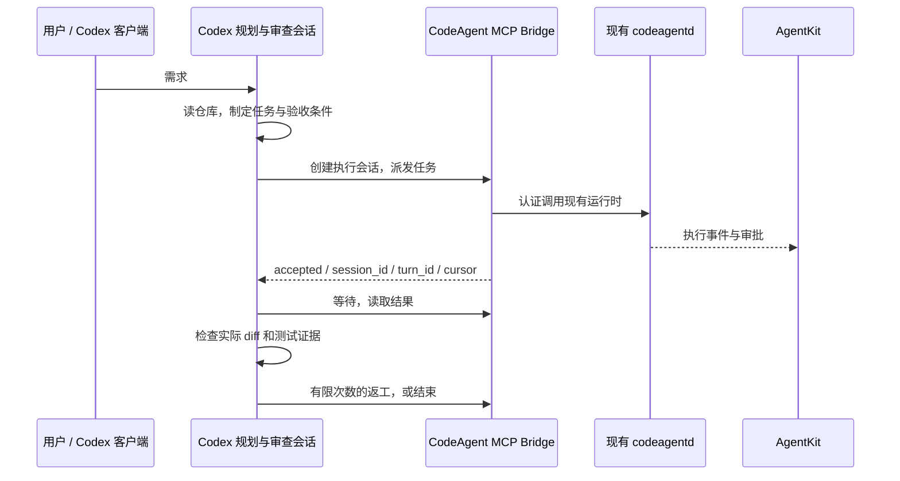

# CodeAgent 与外部 coding agent 协作调研

调研日期：2026-10-27。范围：本地代码静态检查、已安装 CLI 的版本和帮助、官方文档及项目文档。未启动外部模型任务，未做端到端互通或性能测试。以下拟议接口均为设计建议，不代表已有功能。

## 结论

可行，而且已经有同类产品和开源实现。最适合当前项目的第一步是：Codex 作为规划者和审查者，通过 MCP 工具把执行任务交给已经运行的 CodeAgent daemon；执行过程继续在 AgentKit 中可见。第二步再让 CodeAgent 主动调用 Codex、Claude Code、OpenCode，形成双向委派。

这里要接入的是完整 agent runtime，而不只是换一个模型 API。只调用模型不能直接保留 Codex / Claude Code 的会话管理、工具执行、压缩和审查流程。用户观察到的速度与规划质量是值得验证的工作假设，不能据此推导所有任务都会更快。

## 1. 当前项目已有的基础

| 代码位置 | 已有能力 | 对接意义 |
|---|---|---|
| `internal/tools/tool.go` | `SessionControl`、派发回执、turn ID、cursor、会话创建、等待 | 可以作为桥接服务的内部端口 |
| `internal/controlplane/owner.go`、`control.go` | owner lease、认证路由、本地与跨进程派发 | 复用执行所有权，避免另起一个脱离 GUI 的 worker |
| `internal/tools/sessions/send_to_session.go` | 目标会话独立使用模型、凭证、工具、策略和调度器；忙时排队 | 适合作为异步任务派发语义 |
| `internal/runtime/flux_cross_workspace.go` | v1 并发派发，v2 实现后独立审查 | 已具备分工的基本形态 |
| `internal/server/mux.go`、`ws.go` | HTTP 会话创建/查询/事件，WebSocket `send_message`、`cancel_turn`、审批响应 | 可给独立桥接进程复用 |
| `internal/mcp/` | 消费外部 MCP 服务并注册工具 | CodeAgent 可使用外部协作工具；不等于自身已经提供 MCP server |
| `../chater/Talkify/CodeAgentDaemon.swift` | macOS 启动 `codeagentd`，HTTP/WebSocket loopback 通信，随机 token、端口发现、崩溃恢复 | 不必通过 TUI 输入模拟来集成 |
| `../chater/Talkify/AppContainer.swift` | daemon 注册为 RuntimeServerConnection | 可保留现有 AgentKit 接入方式 |

当前 `SessionCreateRequest` 没有外部 runtime 类型，`RuntimeTarget` 直接使用 CodeAgent 的 TurnExecutor。不能把一个 Codex thread ID 填进现有 session ID 就得到互通。外部会话还需要身份映射、事件存储、发现和读取适配，不能只替换 Send。

两个需要明确的现状：

- v2 的实际图是 `implement → wait → read → review → wait → read → end`。`max_iterations` 虽然声明并设有默认值，但未参与返工分支；目前没有自动实现—审查循环，也没有把 REQUEST_CHANGES 转成工作流失败的判定。
- `send_to_session` 的 `intent=notification` 也会执行目标 turn 并可能回复，它不是被动投递邮箱。将其直接用于 agent 群聊容易造成往返触发。

## 2. 各 agent 的接入能力

| Agent | 官方入口 | 当前项目的建议用法 |
|---|---|---|
| Codex | `codex exec --json`、SDK、app-server JSON-RPC | 简单规划/审查先用 exec；需要长会话、流式事件、审批和中断时用 app-server |
| Claude Code | `claude -p`、JSON / stream-json、Python / TypeScript Agent SDK | Go 可先托管 CLI；复杂的双向审批和会话控制再选择 SDK sidecar |
| OpenCode | `opencode serve` HTTP/OpenAPI、SSE、SDK；`opencode acp` | Go 直接调用 HTTP；若建设统一外部 agent 客户端则评估 ACP |

Codex app-server 支持 thread 创建/恢复、turn 启动/steer/interrupt、事件以及 `review/start`。Go 可直接使用 JSON-RPC，不强制引入 Node。首选本地 stdio，并固定 CLI 版本、生成对应 schema；官方将 app-server 命令标为 experimental，不能把它当作无版本风险的稳定生产接口。[官方文档](https://developers.openai.com/codex/app-server)

重要变更：旧的 `codex mcp-server` 已移除。旧教程中“把 Codex 自身作为 MCP server”这条路径不能作为新实现基线；Codex 仍然能作为 MCP client 调用 CodeAgent 提供的工具。[迁移说明](https://developers.openai.com/codex/guides/agents-sdk)

`codex exec --json` 提供 JSONL 事件，`--output-schema` 可约束结果，支持显式 session 恢复，适合第一版规划/审查适配器。[非交互模式](https://developers.openai.com/codex/noninteractive)、[SDK](https://developers.openai.com/codex/sdk)

Claude 的 Agent SDK 保留 Claude Code 的工具、agent loop 和上下文管理；CLI 支持结构化输出和会话恢复。流式 CLI 输出需核对 `--verbose` 等配套选项。若做对外产品，官方文档明确：未经批准，第三方开发者不能向用户提供 claude.ai 登录或额度，应使用文档规定的 API key 认证方式；不能把个人本机使用直接推广为产品的订阅额度方案。[非交互接口](https://code.claude.com/docs/en/headless)、[SDK 与认证说明](https://code.claude.com/docs/en/agent-sdk/overview)

OpenCode 提供 session 创建、异步 prompt、abort、权限响应和 SSE 事件。要接管已存在的 TUI 会话，应连接其实际 server；另起 `opencode serve` 会启动新的 server。[Server API](https://opencode.ai/docs/server/)、[ACP](https://opencode.ai/docs/acp/)

本机检查：Codex 为 `0.164.0-alpha.11.1`，Claude Code 为 `2.1.239`；当前 shell PATH 未发现 OpenCode。仅核对帮助，未验证账户权限、模型可用性或实际运行行为。在线文档可能领先于本机版本，实施时以所固定版本的 schema 和 CLI 帮助为准。

## 3. 市场上已有的相似功能

| 项目 | 已公开的能力 | 与本需求的关系 |
|---|---|---|
| PAL MCP / clink | 从 Claude Code、Codex 等 CLI 委派另一个 CLI；planner、codereviewer 角色和 continuation | 最接近“一个 agent 请另一个 agent 做事”；支持添加自定义 CLI 配置，CodeAgent 仍需适配 |
| MCP Agent Mail Rust | agent 身份、收件箱、线程、消息回执、文件预约 | 最接近“异构 agent 互相发消息”；执行唤醒与审批仍要由 runtime/集成层承接 |
| Agor | 多种 agent harness 的统一工作区；通过 MCP 创建同行会话、派发工作、报告结果 | 最接近 AgentKit 上层的多 agent 工作台，可以参考产品交互和控制面设计 |

以上依据项目自己发布的文档，未安装、压测或审计。[PAL](https://github.com/BeehiveInnovations/pal-mcp-server)、[clink 文档](https://github.com/BeehiveInnovations/pal-mcp-server/blob/main/docs/tools/clink.md)、[Agent Mail Rust](https://github.com/Dicklesworthstone/mcp_agent_mail_rust)、[Agor](https://agor.live/)

复用边界：PAL 的 clink 文档列出的默认 Codex 配置包含绕过 sandbox/审批的参数，不应直接照搬进 CodeAgent。Agent Mail 的文件预约属于协作约定，不能代替 filesystem sandbox。旧 Python `mcp_agent_mail` 仓库已声明被 Rust 版本取代。现成项目证明这个方向已有实践，但没有证据表明它们已支持本项目的 Agent Wire 或 AgentKit。

## 4. 推荐实现顺序

### 第一阶段：Codex 委派 CodeAgent

新增一个薄的 MCP server，复用内部 SessionControl / SessionIndex 服务，或通过明确配置的 daemon HTTP/WebSocket 客户端转发。第一版选择一种路径即可。外部进程桥接时必须处理现有 WS 的连接、事件和审批语义；不要假设已经存在公开的 `POST /v1/conversations/{id}/turns`。

建议工具是 create、send、wait、read、cancel；这些是拟议对外工具，不能仅把内部工具 schema 原样导出。桥接层必须补充调用者身份、工作区授权范围和幂等请求 ID。初期可仅允许访问桥接创建的执行会话；只有明确关联后才暴露既有用户会话。

派发立即返回回执，等待采用有上限的调用，结果从 daemon 获取。MCP RPC 超时或客户端断线不等于后台任务被取消；取消要显式映射到目标 turn。完成结果必须能恢复读取。

规划与复审在用户使用的 Codex 客户端中完成，因此此阶段不需要 CodeAgent 主动托管 Codex，也不依赖已移除的 Codex MCP server。客户端必须能配置 MCP；不能默认新启动的 Codex app-server 就能控制桌面 App 当前打开的对话。

### 第二阶段：CodeAgent 双向调用外部 agent

在 daemon 中增加外部 agent 适配层，而不是在 Swift UI 中直接管理每家 CLI。这样 TUI、AgentKit 和服务器入口可以共享能力。

- 先支持 `codex exec --json` 的 plan / review 任务，验证结果结构和效益；再按需求升级到 app-server 的持续会话和审批。
- Claude Code 使用 CLI 或 SDK；OpenCode 使用 HTTP API。保留各自 native session ID。
- 统一模型包含 `runtime_kind`、`external_session_id`、`workspace`、能力集合、状态和原始事件引用。它与现有 LLM `model.Provider` 是不同层次。
- 同时适配派发、等待、读取、发现、取消和审批；跨 runtime 的 fork、steer 不支持时明确返回 unsupported，不伪装成功。
- 初期提供独立外部任务工具，避免一次改写所有会话语义；验证后再将其纳入统一会话控制面与 AgentKit 时间线。

### 第三阶段：统一会话与有边界的协作

AgentKit 展示每个任务的 planner、executor、reviewer、workspace、审批和执行证据；支持跨 runtime 的追问与返工。与现有 Flux 集成时，先补齐 v2 的 verdict 解析、条件分支和返工次数上限，再接入外部 reviewer。

MCP 用于外部 agent 调用 CodeAgent 工具；ACP 用于客户端统一驱动 coding agent；A2A 用于独立 agent 服务间的发现和任务协作。它们不互相替代。ACP 官方生态列有 Codex 和 Claude 的适配器，OpenCode 有原生 ACP 入口，但依然要验证版本、审批和恢复行为；A2A 也不会自动让这三个 CLI 互通。对当前本机场景，先做 MCP 与具体 runtime adapter，跨机器互联出现实际需求后再考虑 A2A。[ACP 定义](https://agentclientprotocol.com/get-started/introduction)、[ACP agents](https://agentclientprotocol.com/get-started/agents)、[A2A 定义](https://a2a-protocol.org/latest/)

## 5. 协作协议需要保留什么

任务至少包含：目标、验收条件、允许修改范围、禁止事项、workspace/worktree、基线 revision、父任务、request ID、预算与截止时间。完成包至少包含：结果状态、实际 diff 或 patch 的引用与 hash、修改文件、测试命令/退出码/日志引用、未完成项。

审查结果应是可校验的 verdict + findings，不只依赖自然语言成功声明。审查者要能读到实际源文件和对应改动；executor 不能在审查期间继续改动同一份代码。第一版可采用同一专用 worktree 串行交接；并行 worker 使用独立 worktree。dirty workspace 以 patch hash 标识，commit SHA 不足以标识未提交结果。

委派权限与执行权限分别判断：允许调用 send 不代表目标可任意运行命令。CodeAgent 的命令策略不会自动约束外部 Codex/Claude 进程，必须配置目标 runtime 的 sandbox/工具权限，必要时增加进程级隔离。daemon token 通过显式、受保护的本地绑定传递，不写入 prompt、MCP 结果或审计明文。

消息要区分 work request、result、review、被动通知；保存 sender、recipient、父任务和 correlation。每条任务链设置返工次数、调用深度和总预算，完成报告不再自动触发“谢谢”回复。传递可核对的计划、结论和证据，不依赖复制完整隐藏推理或把所有历史塞给每个 agent。

## 6. 最小验证与收益判断

先做一条路径：用户在 Codex 提需求 → 通过桥接创建 CodeAgent 执行会话 → AgentKit 可见执行 → 返回真实 diff 与测试证据 → Codex 审查 → 最多有限次数返工。不要第一版同时实现三家所有功能。

接入测试应覆盖：固定版本的协议契约、重复派发去重、目标忙时排队、等待超时后恢复、任务取消、审批挂起与恢复、daemon 重启后的会话/端口重新关联，以及 workspace 越界拒绝。外部 CLI 使用 fake/recorded transport 做日常测试，另有显式启用的真实环境验证。

同一批代表性任务比较：CodeAgent 单独执行、Codex 单独执行、Codex 规划+审查与 CodeAgent 执行。记录总耗时、模型使用量/实际可取得的费用、首次测试通过率、漏检问题、返工次数和人工介入。混合路径有额外规划和审查延迟；其收益需要质量和返工减少来证明。

建议先实现第一阶段的 CodeAgent MCP Bridge。它最直接满足当前诉求，能继续利用现有 daemon 与 AgentKit；只有在流程收益得到验证之后，再扩展到完整的异构 agent 控制面。
