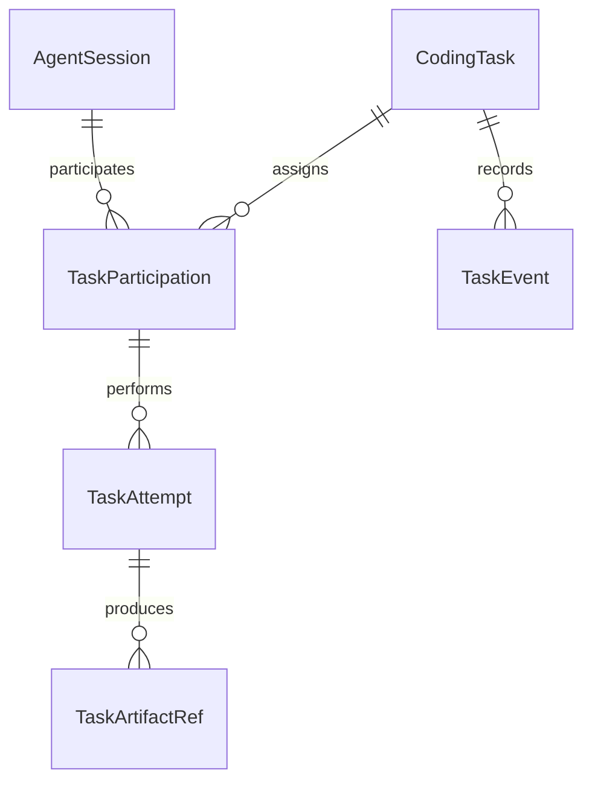

# P0-B 最小 Task / Session 与 AgentKit 数据契约

2026-10-27。设计草案，未实现、未迁移数据库、未修改 AgentKit UI。P0-A 接口按 [职责边界复核](p0a-agent-boundaries.md) 冻结。本提案细化后续范围；原 [总体设计](collaborative-workspace-p0-design.md) 中完整 ReviewGate、Outbox 和控制恢复不全部挤入第一批实现。

实施状态更新：B1 的最小关联层已实现，实际 API、身份限制、独立 TaskEvent 表、查询驱动投影、迁移与回滚见 [B1 实现说明](p0b1-implementation.md)。本文保留提案历史；HTTP 轮询先行，Task WebSocket/审批摘要不在本批范围。

## 1. 分批交付

| 批次 | 目标 | 内容 | 不承诺 |
| --- | --- | --- | --- |
| P0-B1 | 能关联、能解释、能回放 | Task / Participation / Attempt 关联；持久里程碑；计划/审查回报；父任务 snapshot；AgentKit fixture 与 DTO 契约 | 自动执行/返工、正式任务验收、跨进程重派发 |
| P0-B2 | 可恢复的协作闭环 | Flux 唯一调度入口、ReviewGate、精确产物版本、执行 admission 和恢复核对 | 自动复活外部 Codex、通用 Agent 生命周期管理 |
| P0-C | 控制与恢复保障 | 持久化控制命令、Outbox 的跨库提交适配、审批恢复和操作 fencing 的完整故障验证 | 不依赖实验代理补齐这些保证 |
| P0.5 | 工作区交互 | 消费稳定 Task 协议，父任务 Timeline、子会话导航、审批和 Diff | 不把各 Agent 的事件混入单会话 reducer |

B1 是可观察的关联层，不能包装成已可恢复调度的 Collaborative Mode。B2 若需要跨库 Outbox 或不可变产物才能成立，就将相应最小能力作为 B2 前置，不把依赖拖到 C 后宣称完成。

B1 不增加新的调度循环。现有 Session 手工委派继续执行，B1 只关联精确回执；B2 的受管任务由 Flux 唯一派发。不能同时允许 Flux 和调用方自由 send 同一执行 attempt。

## 2. 身份与关系

- Task 表达目标、验收条件和当前协作状态，独立于 Agent 品牌及模型。普通单 Agent 对话无需创建 Task。
- Session 表达某 Runtime 的连续上下文。本地引用使用 server/store/session；外部引用使用 Daemon 注册的 opaque session_handle，native_session_id 可缺省，不从 MCP clientInfo 推断。
- Participation 表达“某 Session 在某 Task 中以某角色参与”。role 为 planner / executor / reviewer；不存入 Agent 的永久属性，也不写进 Session 的唯一 task_id 字段。
- 同一外部 Session 可以在 Task A 规划、Task B 审查；同一任务的 planner/reviewer 可使用同一 Session 的两个 participation_id。独立审查必须另建真实上下文，并由策略显式要求，不能仅凭不同角色卡片宣称独立。
- Attempt 表达特定 participation 的一次阶段工作。执行绑定确切 turn_id / request_id；外部回报绑定 producer_submission_id，不能伪造本地 Turn。
- 单写入者约束作用于 workspace 和活动写入 attempt，不能用“一个 Session 只允许属于一个 Task”替代。外部上下文复用的污染风险以关联提示和显式独立上下文策略处理；不自动复制历史。

这取代总体提案第 4 节“每个 Session 只归属一个 Task”的初期限制。Task 和 Session 的父子展示关系不改变原 parent_session_id 的 spawn/fork 语义。

角色与 runtime_kind 解耦：P0-B 初始路径仍使用外部 Codex + 本地 Code-Agent；P1 按 Adapter capability 开放角色矩阵，而非按 Agent 品牌硬编码角色。P1 的角色变化创建新的 participation，历史 attempt 保持原引用，不原地改写。

## 3. 最小领域数据

| 对象 | 必需数据 | 不变量 |
| --- | --- | --- |
| CodingTask | task_id、workspace_ref、goal、acceptance、mode、state、phase、revision、snapshot_task_seq | 无默认 agent_id；无 max_tokens / thinking；workflow_ref 在 B1 可为空 |
| TaskParticipation | participation_id、task_id、agent_id、role、session_ref、observation_level、capabilities | role 只在此关联生效；Agent 身份来自认证主体/注册绑定，不信任模型自报 |
| TaskAttempt | attempt_id、participation_id、stage、iteration、status、source_ref、execution_evidence | turn_id 对 reported 外部工作允许 null；不能读取 last_turn 代替绑定 |
| TaskArtifactRef | artifact_id、attempt_id、kind、version、content_hash、source_ref、capture_mode、truncated | current_workspace 与 immutable_snapshot 必须区分；hash 本身不提供不可变读取 |
| TaskEvent | event_id、task_id、task_seq、task_revision、kind、recorded_at、participation_id?、attempt_id?、source、payload | 由 Daemon 排序持久化；event_id 为父卡片身份，不能用 call_id 或角色当唯一 key |

SessionRef 为 tagged union：`local` 携带 server_id/store_id/session_id，`external` 携带 agent_id/session_handle/runtime_kind；本地会话详情才使用现有 ConversationSupervisor。外部详情显示已回报记录；没有 native ID 时不显示虚构的原生会话链接。

Task state 沿用 active / waiting / paused / completed / failed / cancelled；phase 为 planning / implementing / reviewing / reworking / finalizing。阶段完成、执行证据和任务验收分别保存；一个 Turn completed 不能自动将 Task completed。B1 不暴露完成任务、暂停或取消 Task 的动作；这些状态只在对应服务能力实际实现后启用。

审查产物保留 verdict `pass / request_changes / inconclusive`、reviewed_attempt_id、reviewed_artifact_id/version/hash 和 findings，但 B1 仅存为 reported review，不自动派发返工或声称 ReviewGate 已接受。正式验收状态由 B2 门禁产生。

## 4. HTTP 和 MCP 边界

以下为未来接口草案，现有端点均不改变。B1 能力 `task_links_v1`、`task_timeline_v1`；B2 另增 `task_managed_workflow_v1`、`task_review_gate_v1`；控制能力逐项声明，不能用一个总开关掩盖差异。

| 拟议 API | 行为 |
| --- | --- |
| POST /v1/tasks | 幂等建立 goal/acceptance，不自动创建或启动 Agent |
| POST /v1/tasks/{id}/participations | 验证已有 Session 的范围/身份并关联，允许同一 Session 跨 Task 复用 |
| POST /v1/tasks/{id}/attempts | 绑定已准入的精确本地 Turn，或登记外部回报；不触发执行 |
| POST /v1/tasks/{id}/plans | 版本化计划回报，引用 planner participation |
| POST /v1/tasks/{id}/reviews | 版本化审查回报，B1 返回 recorded，B2 才可能 gate_accepted |
| GET /v1/tasks?workspace_ref=... | Task 列表；不把 Task 伪装成 Conversation |
| GET /v1/tasks/{id} | 一致性 snapshot、水位、available_actions 和来源 |
| GET /v1/tasks/{id}/events?after=... | 只读持久事件分页，after 是 Task cursor |
| GET /v1/tasks/{id}/stream?after=... | 可选只读 WS；未实现时 HTTP 增量轮询足够 |

P0-A 七个 MCP 工具及 SendInput 保持不变；不要求创建 Task，也不让 Bridge 分配内部输出参数。未来新增 Task 工具须单独声明 capability，与 HTTP 复用领域服务。创建/回报权不等于任意绑定他人会话或审批权。

所有 mutation 使用 request_id + actor + task scope + payload_hash 去重，同键不同 payload 返回 409。绑定执行 Turn 前核对 server/store/session/turn/workspace 和 durable admission；错误主体返回 403/404，绑定其他任务的同一 Turn 返回 409。允许 Session 复用不表示允许同一执行 Turn 对两个任务重复记账。绑定晚到时从该 Turn 的持久事件补投影。

B1 不发送模型请求，没有模型预算管理器。资源预算保持独立议题；没有实现就不宣告 budget_enforced，也不引入隐性输出截断。

## 5. TaskEvent 与 AgentKit 消费规则

最小 kind：`task.created`、`participation.attached`、`plan.reported`、`attempt.linked`、`attempt.started`、`attempt.completed`、`attempt.failed`、`attempt.cancelled`、`attention.updated`、`artifact.linked`、`review.reported`。B2 再增加 reviewed / rework_authorized / task.completed 等门禁决定。模型不能调用通用 emit_event 任意改变 Task 状态。

TaskEvent 只保留里程碑和下钻引用。token delta、完整 Thinking、工具参数与 stdout 留在原 Session 流，不跨 Session 复制或重新排序。reported 来源只能显示提交内容与回报时间，不能显示不存在的受管工具进度或暂停按钮。

TaskSnapshot 中的 participations、attempts、artifact_refs、pending_attention、available_actions 和 snapshot_task_seq 来自一致性读取。seq/revision 为十进制字符串，时间为 UTC RFC3339；未知费用和 Token 汇总使用 null，不能显示成 0。

客户端流程：

1. 获取 snapshot S，保存其 snapshot_task_seq。
2. 增量读取 after=S，按 task_seq 排序、event_id 去重；游标只在成功解码/接纳后推进。
3. B1 事件含 milestone 和失效提示，推进 cursor 后重新获取更高水位 snapshot；在应用该 snapshot 后丢弃已覆盖事件。父卡片按稳定 event_id 保留，不将过期快照覆盖新水位。
4. WS 只唤醒读取持久日志；若实现 backlog + live，先固定水位，再补历史，避免订阅竞态。task_seq 允许空洞，不能把 `seq != previous+1` 当丢事件；由服务端 cursor_expired / resync_required 决定重取。
5. 未知 kind 保留为通用来源卡片并重取 snapshot；不送入现有 AgentEvent 解码器或 ExecutionReducer。

审批摘要精确引用 server/session/turn/approval。用户点击后路由到该 Session 的 RuntimeSessionChannel，不能发给当前选中的会话。Task 流保持只读，不建立审批 sink。

## 6. 实际代码接入点与改动范围

| 位置 | 后续最小改动 |
| --- | --- |
| 新 internal/collab 类型/窄服务端口 | Task、Participation、Attempt、Snapshot、领域校验和查询；不包含 LLM 循环 |
| internal/session/sqlite | 在既有数据库增加关联表/Task 分区及窄事务端口；Task 变更与事件、投影 checkpoint 一起提交 |
| internal/conversation/repository.go / eventstore.go | 保持原接口；新增 optional port，第三方 store 不具备时不发布 task capability |
| internal/server | 独立 Task DTO/API，复用认证；不改 AgentWire Session 事件 kind |
| AgentKit Core | 将来新增 TaskClient / TaskSnapshot / TaskEvent / TaskStore；能力缺失时保留单会话入口 |
| AgentKit Features/Workspace | 将来新增 taskDetail 导航；当前 WorkspaceStore.selectItem 和 selectedConversation 不能直接混用 Task ID |
| AgentKit ConversationSupervisor / RuntimeSessionChannel | 本地子会话复用 controller(for:) 和 session-bound channel，维持审批精确路由 |
| AgentKit TimelineProjection / ArtifactNode | 父任务另建 TaskTimelineProjection；不复用仅以 callID 标识的 ArtifactNode 作为跨 Session 产物身份 |
| chater Mac/iOS 与 TUI | 后续注入同一 Task 客户端；本轮不修改源码或 UI |

已核对本地 Repository 的 Create 会注入本地系统提示，不能拿它创建假 Codex 会话。本最小方案将外部 session_handle 保存在参与关系的 external SessionRef 中，不进入本地 ConversationRepository；P1 Adapter 接入后才按其原生会话能力管理。原总体提案的 observed Session 创建端口因此不再是 B1 的必需迁移。

TaskEvent 可复用现有 session_events 的 `task:<task_id>` 内部分区，但须先验证该 store 的访问隔离和查询开销；它不是 Conversation。投影唯一键包含 source_server_id/store_id/session_id/seq/projection_kind，避免工具 call_id 在不同会话碰撞。实时 SubscriptionManager 只负责唤醒，重启要扫持久水位。

Flux 与 Session SQLite 仍跨库。B1 无 Flux 提交，所以无新增跨库原子提交承诺；B2 在 durable command/outbox 与 Flux 幂等查找验证完成前不得自动恢复派发。无法确认是否执行过时进入 recovery_required，不盲重放副作用。

## 7. 设计验收与后续顺序

配套 [snapshot/event 示例](contracts/p0b-task-example.json) 为虚构 fixture，不是真实实验，也不是已发布的 HTTP 响应。它用于后续 Go/Swift 解码对照，不在本轮添加生产协议类型。

实施前至少固定这些契约测试：单 Agent 不创建 Task；同一 Codex Session 在两任务承担不同角色；同一任务同一 Session 两角色保持独立 participation；跨 workspace/主体关联拒绝；重复回报去重；精确 Turn 绑定；终态先发生后关联可回补；重连不漏/重卡片；未知 kind 降级；reported 不显示 managed 操作；Task 页审批仍按原 Session 路由。

建议下一批只实施 B1 的关联持久化 + HTTP snapshot/events + Go/Swift fixture 解码。通过后再单独审阅 B2 admission / ReviewGate / Flux 恢复方案，最后接 AgentKit 父任务 UI。真实模型全链路成功不是设计工作的前置条件，也不能替代上述协议/恢复测试。
