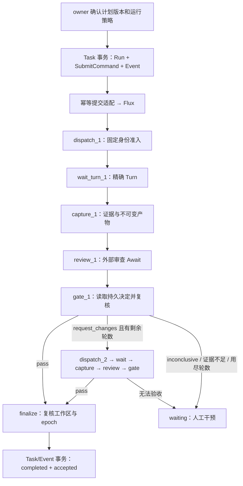

# P0-B2 可实施设计与离线验证

2026-10-28。**本批是设计和技术验证，不是 B2 功能发布。** 用户选择先完成方案与离线验证。只新增本文和 `tests/p0b2/feasibility_test.go`；不修改生产代码、现有测试断言、数据库迁移、AgentKit/Talkify、Agent Loop 或模型参数。不启动另一个 Daemon，不派发真实 Turn，不调用第三方模型。

基于 [B1 实现](p0b1-implementation.md)、[Task/Session 契约](p0b-task-session-contract.md) 和本地锁定的 `flux-workflow v1.0.7`。原契约中的 B2 目标保留；本方案把成立所必需的最小跨库投递账本和不可变产物提前到 B2，不承诺完整 P0-C。

## 1. 结论与范围

可以沿现有架构实现 B2，无需增加 Supervisor，也不需要修改 Agent Loop。Flux 的条件 DAG、持久 AwaitBinding 和事务 Repository 足以作为基础，但现有 `plan_workflow` / `send_to_session` 不能直接组合后宣称得到安全、可恢复的协作闭环。

第一版限定：同一个 Daemon/Session Store、一个受控工作区、一个本地执行 Participation、已回报的计划、外部 reported 审查，以及有限次实现/审查轮次。默认建议两轮，`max_iterations=2` 表示初次实现加一次返工，范围 1–5。角色来自 Participation，不按 Agent 品牌硬编码；不主动启动或恢复外部 Codex。

“可恢复”指：恢复持久关联和等待；重新投递已证明幂等的命令；已知 Turn 继续观测；确认未开始的准入可以按原身份继续。无法确认副作用结果的执行进入 `waiting/recovery_required`，不盲目重跑。它不代表任意中断的编程 Turn 都能无人介入地继续。

不做：父 Task UI、自动管理外部 Agent 生命周期、并行写工作区、通用跨 Store 任务、完整持久化暂停/取消/审批恢复、自动追加预算、生成参数控制。所有能力仅在真实接线和故障测试通过后声明。

## 2. 源码核对出的实施约束

| 接入点 | 当前事实 | B2 处理 |
| --- | --- | --- |
| `internal/session/sqlite/tasks.go` | B1 事务写 Task/Event/receipt；精确 Turn 关联；查询驱动补投影；回报始终 `recorded` | 保留 B1 行为；B2 另有受管运行服务和门禁，不能把旧审查回报升级成 PASS |
| `internal/session/sqlite/tasks_schema.go` | Task 表与 Session/Event/turn_inputs 同库，schema version 1 | 可在同一 SQLite 事务提交准入、Attempt 与 TaskEvent，不需要跨库提交这些对象 |
| `internal/conversation/executor.go: AcceptCrossSessionMessage` | request 会设置目标 Session 的临时 `full` 审批模式 | **B2 阻塞项**：新受管准入必须保留目标权限；没有审批接收端就等待人工，不能自动提权 |
| `internal/tools/sessions/send_to_session.go` | 每次调用生成随机 MessageID | 不作为受管派发的重试单元；改用持久 DispatchReservation 的固定 request/message ID |
| `internal/session/sqlite/turn_input.go` | 同 Session/request 重复返回原 Turn/hash；TurnExecutor 比较 payload hash 后拒绝冲突 | 复用准入语义，补齐与 TaskAttempt/fence 的同事务绑定；不能仅依赖 Store 自己拒绝冲突 |
| `internal/conversation/executor.go: Resume/recoverTurnInputs/executeRecoveredTurn` | 当前普通会话有独立恢复路径 | 受管来源必须先恢复核对和 fencing；不能只拦 HTTP 或新的 send 路径 |
| `internal/runtime/headless.go` | headless nested executor 直接调用工具 Execute，适用已授权触发器 | 不用它承载 B2 任意代码工具；Flux 域节点只通过正常 TurnExecutor 派发 |
| `internal/runtime/flux_cross_workspace.go` | v2 无 verdict 分支或真实返工循环；读取 `last_turn` | 新增 `coding_collaboration_v1`，不改变历史 v1/v2 定义或用 last_turn 验收 |
| `internal/runtime/flux_tool.go` | 本地 Runtime 池、内存工具注册；启动时捕获 resolver；恢复 scanner 关闭 | 受管节点/resolver 在 worker 启动前注册；先恢复身份和 fence，再恢复可投递队列 |
| Flux `Runtime.Submit` | 同业务 input 提交两次得到两个任务；Create 与 Enqueue 分开 | 增加稳定 command receipt 的宿主适配，不能靠 input 中写 command_id 获得去重 |
| Flux `NewLocal` | SQLite 存状态，任务队列和锁在内存 | 重启扫描 B2 自有映射中的已知 pending 任务并重新入队；不把“数据库存在”当执行恢复 |
| Flux `CompleteAwait` | 回填 Await 后入队，方法返回成功不等于下游已经执行完成 | 完成回执与 Task completed 分开；补测回填后、消费前重启 |
| `internal/server/tasks.go` | owner Bearer only；外部身份是 owner 注册的 reported 引用 | 不放宽认证；不是外部 Agent 的密码学身份认证，也不是其生命周期管理授权 |

本地依赖来源是 Go module cache 中锁定版本的 `runtime/runtime.go`、`runtime/internal/taskqueue_memory.go`、`engine/await_complete.go`、`repository/query/task.go`。未联网查询或更换依赖。

## 3. 唯一调度与有限 DAG



实际编译为有限展开 DAG，每轮都有独立稳定节点名。Flux 决定下一步，命令投递器只搬运已提交命令，不决定阶段或生成新返工。Retry 仅用于明确可重放的基础设施操作；不能用重置子树代替业务返工。

Await provider 分为 `coding_task_turn_v1`、`coding_task_review_v1`，correlation 包含 Task/run/attempt/epoch 和确切来源。现有 Session resolver 通过类型分派继续服务旧流程；未知 provider 明确拒绝，不能把 review 解释为 Session turn_finished。外部客户端断开只是继续等待，不自行启动外部 Agent。

审查 HTTP 提交先持久化 gate decision；resolver 返回该 decision 的引用。门禁节点从 Task Store 读决定，而不是信任任意 `CompleteAwait` payload 的 verdict。通用 workflow retry/resume/complete 接口不得绕过受管节点的复核。

## 4. 事务与幂等设计

复用 B1 optional Repository，不向所有第三方 Repository 增加必选方法。新增可选 ManagedTask/Admission Port，未装配不声明 `task_managed_workflow_v1` 或 `task_review_gate_v1`。普通会话不创建 Task，不经过 Flux，不产生 TaskEvent。

建议新增的内部表如下；具体 SQL 随实现提交迁移测试，不在本批执行迁移。

| 位置 | 表/记录 | 关键约束 |
| --- | --- | --- |
| Session SQLite | `coding_task_runs` | run_id、Task、固定计划 artifact/version/hash、workflow version/hash、control_epoch、轮数、状态；每 Task 最多一个活动 Run |
| Session SQLite | `coding_task_commands` | command_id、kind、payload/hash、来源 Run/epoch、receipt、投递状态；Task 变更/Event/command 同事务 |
| Session SQLite | `coding_task_dispatches` | 派发前的 reservation；固定 request_id、目标 Participation/Session、消息 hash、epoch；准入前不伪造 Attempt/Turn |
| Session SQLite | `coding_task_workspace_claims` | 可信工作区身份 → 活动 Run；单写入 claim，不按 Session 永久锁定角色 |
| Session SQLite | `coding_task_artifact_blobs` | 服务端计算 hash、不可变内容；引用沿用 B1 artifacts 表，事务内关联 manifest、证据和 Event |
| Session SQLite | `coding_task_gate_decisions` | 审查来源、review artifact、绑定元组、门禁结果、幂等键；不能由模型直接写 Task 状态 |
| Flux SQLite | `codeagent_submission_receipts` | `(source_store_id, command_id)` 唯一，payload/version hash 和唯一 flux_task_id；与 Flux Task 同事务创建 |

Task 的 B1 `workflow_ref` 字符串保留，新增可选 managed_run 描述 Run/epoch/版本，不静默改成新 JSON 类型。seq/revision/epoch/Flux ID 对外继续十进制字符串。B1 schema 文档和 JSON fixture 保持兼容。

### 4.1 提交到 Flux

1. Task Store 事务验证 actor、Participation、计划版本、工作区和没有活动 Run，创建 Run/SubmitCommand，推进 revision 与 TaskEvent。
2. 宿主 adapter 在 Flux DB 事务查 command receipt。已有同 hash 返回原 Task ID；不同 hash 返回 conflict。没有时使用事务 Repository 创建 Task、绑定 RootID、固定 workflow definition/version，并写 receipt。
3. 提交成功后才 Enqueue；不能把入内存队列纳入 SQLite 原子提交承诺。跨库 ACK 丢失时重新查 receipt，不再次调用非幂等 Submit。
4. 启动或投递失败时，只重新入队 receipt 对应的、已核实 pending 的 B2 Task；running/悬而未决状态先核对节点与派发账本。受管进程独占该执行域，不能同时启用通用 recovery scanner 对这些任务自动 Retry。

离线探针验证了 `Runtime.DB()` + `query.NewTaskRepository(tx, ...)` 可原子创建 Task/命令映射，SQLite 可分配 ID 后在事务内设置 RootID。生产 adapter 仍须绑定 workflow version、先查 receipt、处理并发和主键竞争；不能照搬探针的最简写入函数。保留 PK/receipt 唯一约束，主键碰撞只允许有界回滚重试，不改历史 ID。此路径不要求更换 Flux 依赖。

### 4.2 精确受管 Turn 准入

新增 trusted managed admission 端口，复用 TurnExecutor 的排队、模型解析、工具/审批和持久 inbox。它不能调用当前会临时提升审批的跨 Session request 入口。Task 来源使用显式 tagged provenance，不编造一个本地“Codex Supervisor Session”充当 sender。

在模型调用或工具执行前，同一 Session DB 写事务完成：核对 Run/epoch/目标工作区和 claim → 固定 request/Turn 身份与 payload hash → 写 turn_inputs 和 turn_accepted → 创建精确 TaskAttempt → 更新 reservation/Task/Event。任一步失败全部回滚。同键重试返回同一 Turn；Task/Session/Turn/hash 不符拒绝。

与 B1 手工 LinkAttempt 共用 `(session_id, turn_id)` 唯一约束，防止同 Turn 归属第二个 Task。原 B1 查询投影对受管 Attempt 仍可更新局部生命周期，但不得覆盖 Flux 管理的 Task phase、acceptance 或终态；增加 Run ownership 分支并用乱序查询测试固定行为。

所有 daemon 执行入口，包括普通 send、WebSocket/HTTP、Resume、recoverTurnInputs、executeRecoveredTurn，均须核对工作区 claim；只给新 API 加校验不够。受管输入在 Run 恢复核对完成前不自动恢复。无 Task claim 的普通会话沿原路径运行。

工作区身份绑定可信 canonical root、Store 和 Git worktree 身份；路径/符号链接替换使旧 claim 失效并停止准入。第一版不跨 Store 共享管理权，冲突归属明确拒绝。活动 claim 不因心跳过期而自动释放：必须证明旧写入者停止，或进入 recovery_required。它协调 Runtime 内准入，不能阻止用户编辑器、旧版 CLI 或其他未接入进程写文件；这些修改需通过快照核对检测，不承诺全系统文件锁。

### 4.3 审批与恢复

目标 Session 保留自己的权限。Plan 授权、Review PASS、Flux admission 都不是工具审批。没有审批 sink 时继续 waiting_for_human/attention_required，不改成 full，不在 Bridge 代批。新的任务级交互不改变原 Session 的 allow-once/deny 协议。

本批未来实现仅能恢复“需要用户重新决定”的审批摘要，不自动恢复旧单次许可；进程重启时有未完成工具或审批就冻结自动推进并进入 recovery_required。完整持久审批恢复和强制终止控制仍属 P0-C。新 Run 或显式恢复决定提升 epoch，所有后续准入、capture、review、finalize 检查当前 epoch；epoch 失效不代表旧工具已经停止，确认停止前不得授权新写入者。

## 5. 不可变产物与 ReviewGate

B1 `reported_reference` patch 只有引用和客户端 hash，不能直接作为正式验收对象。B2 由受信宿主 capture，通过 exact attempt 的持久工具事件构建执行证据：命令、exit code、completed/timeout/cancel 状态和期望验证条件。`confirm` 是策略分类；审批通过与命令成功分开判断。后台进程未确认终止、缺少验证或输出截断不能自动变成 tests_passed。

第一版只开放 Git 工作区：开始时固定基线 commit/tree 和 dirty/untracked manifest，执行结束后等待所有本任务进程停止，再生成不可变 review bundle。至少保存修改前后必要文件内容、删除/重命名/模式/二进制信息、patch、验证日志与结构化证据、基线及候选 manifest、精确 Turn/event cursor、plan/attempt/epoch。仅 hash 或只保存可变路径不够；首次实现可在同一 SQLite 保存有大小上限的 blob，超限/不可读/缺失一律 incomplete，不能静默截断后放行。

capture 不自动执行会改变仓库的 git add/commit/stash。路径使用现有安全策略，拒绝越界和跟随逃逸符号链接；敏感/被拒绝路径不因生成 artifact 而绕过限制。变更涉及无法安全捕获的内容时等待人工，不把源文件“省略”成一个完整快照。

审查回报必须包含以下绑定元组，并由服务端验证：

```json
{
  "request_id": "review-request-1",
  "producer_submission_id": "external-submission-1",
  "reviewer_participation_id": "reviewer-1",
  "run_id": "run-1",
  "control_epoch": "1",
  "plan_artifact_id": "plan-1",
  "plan_version": "1",
  "plan_hash": "<sha256>",
  "reviewed_attempt_id": "attempt-1",
  "reviewed_artifact_id": "bundle-1",
  "reviewed_artifact_version": "1",
  "reviewed_artifact_hash": "<sha256>",
  "verdict": "request_changes",
  "findings": [{"id": "finding-1", "message": "具体修改要求"}]
}
```

这是拟议 DTO，不是已发布端点或真实数据。缺失/未知 verdict、错误角色/来源、旧 epoch/产物/计划、错误 hash，分别明确 invalid/forbidden/conflict，不能解释为 pass。重复 request/submission 同 payload 返回原决定，不再次返工；同键不同 payload 冲突。

门禁结果分三层：HTTP `recorded` 表示存下回报；`gate_accepted` 表示当前审查已被有效消费；Task `accepted/completed` 只由 finalize 提交。request_changes 也可被 gate 消费成功，但仍不是任务验收成功。inconclusive、验证不足、轮数用尽均 waiting；不以 Flux TaskSuccess 或 Turn completed 代替 Task 验收。

PASS 在 finalize 再核对当前 Run/epoch、验证证据和候选 manifest。工作区改变则追加失效事件，回到 waiting，不覆盖历史审查。Runtime 受控写入在 claim 下串行；外部编辑无法与 DB 完成事务原子锁定，需在前后校验及后续读取核对中显式失效，不能保证任意外部写入都零延迟被发现。accepted 表示验收了指定 artifact hash，不是对工作区永久有效的承诺。

外部 reported Participation 的“审查者”身份仍是 owner 注册的声明。两个 handle 不足以证明两个独立推理上下文；第一版不自动宣称独立性，也不展示外部工具进度/暂停能力。

## 6. 故障窗口及恢复决定

| 中断点 | 重启后动作 | 禁止行为 |
| --- | --- | --- |
| Task/command 事务前后 | 未提交无运行；已提交按同 command 投递 | 另建 Task/Run 掩盖丢回执 |
| Flux Task/receipt 事务内部 | 全部回滚或同映射存在 | 仅凭“没收到 ACK”再次 Submit |
| Flux 提交后、Enqueue 前；或队列丢失 | 查询映射和 pending 状态，重投同 Flux ID | 分配第二个 Flux Task |
| Turn 准入事务前后 | 原 request 返回原 Turn；同事务 Attempt 已绑定 | 读 last_turn 猜测本次执行 |
| 工具开始后、结果持久化前 | recovery_required，核对进程/证据，人工决定 | 自动重跑未知副作用 |
| capture 事务中 | 无引用则重捕获当前稳定候选；有引用读不可变 blob | 引用旧 hash 读取新路径 |
| 审查入库后、通知前 | resolver 从同一持久决定恢复 | 要求外部 Agent 重做审查或发假终态 |
| Await 回填后、worker 消费前 | 读取已完成 binding/pending-edges，重投同 Flux Task | 把 CompleteAwait 返回成功当最终完成 |
| 旧 epoch 回调/工具晚到 | 拒绝推进、保留审计；旧进程停止前不授权新 writer | 用 TTL 直接抢占写权限 |
| B1 Snapshot 与 Flux 事件乱序 | 单库事务投影、按去重源/水位合并，不倒退 managed state | 查询动作自动派发或把旧 completed 覆盖新返工 |

这个最小投递账本处理提交/审查通知，不等于完整控制 Outbox。跨进程 kill、重复投递、并发、重启顺序和未知工具结果必须在实施阶段实测后才启用恢复能力。

## 7. API、Bridge 与最小改动范围

保留 owner-only Task API。建议新增显式 `POST /v1/tasks/{id}/runs`（固定计划、参与者和轮数，不接受内部生成参数），`POST /v1/tasks/{id}/runs/{run}/reviews`（绑定元组），以及按 Task/Run 授权的不可变 artifact 读取。B1 `/plans`、`/reviews` 继续只回报，不能兼用一个字段让历史客户端意外推进执行。恢复核对入口需携带 expected epoch 和具体决定，不是任意 Retry。

MCP 另增 capability-gated Task 创建/关联、计划回报、Run 启动、Snapshot/Event/Artifact 读取、审查回报工具；复用现有 owner grant、绑定工作区和 Runtime/Store 身份校验。不能因为 owner credential 足够宽就扩大 Bridge 绑定范围。旧七个 Session 工具契约不变；受管 Session/工作区的冲突 send 由 Runtime admission 返回明确 managed-workspace 冲突，不允许与 Flux 并行自由派发同一 Attempt。

| 模块 | 最小改动 |
| --- | --- |
| `internal/collab` | 可选 Run/Admission 服务端口、DTO、门禁绑定与结果；不含 LLM 循环 |
| `internal/session/sqlite` | 增量 schema、Run/command/claim/dispatch/gate/blob 事务；复用 Task/Event 原子写入和全局 Turn 唯一约束 |
| `internal/conversation`、`internal/controlplane` | trusted managed admission、来源类型、全部恢复入口 fencing；保留目标审批，精确准入回执 |
| `internal/runtime` | 新有限 DAG、窄域节点、resolver 类型分派、Flux receipt adapter 与启动恢复核对；不改旧模板历史 |
| `internal/server` | 显式受管 API/能力、owner 校验、冲突/attention 返回；普通单会话 API 保持兼容 |
| `internal/mcpbridge` | 新 Task 工具复用上述服务；保留安全 reattach；不管模型内部参数、不代批 |
| `docs/contracts`、Go/Swift fixture tests | Run/epoch/产物/门禁/attention 增量 DTO；旧 fixture 仍可解码；不改 AgentKit UI |

实施拆成三个可审阅子批次：B2-a 准入/审批边界、稳定 command 与跨库 receipt；B2-b 不可变 bundle、ReviewGate 与新 DAG；B2-c 启动核对、故障注入、协议兼容与离线全闭环。a/b 仅内部能力，c 验收前不发布 managed workflow capability。

迁移使用新增表/索引和可选 JSON 字段，Task schema 升至受支持的新版本，不悄悄改变 B1 行。旧二进制遇新 schema 应拒绝写入，而非忽略受管 claim。回滚先停准入并确认全部受管进程停止，备份 Session/Flux 两库，再回滚版本/新增表；不能删除仍有待投递命令或活动 Run 的表，也不能仅回滚一库后继续执行。没有 Task 的单 Agent 安装不要求创建 Run 或启动 Flux。

## 8. 本次实际离线验证

新增测试是实际调用锁定 Flux/Session SQLite 的技术探针，不是用 mock 状态机证明自己。仅阶段动作使用进程内 recorder，零模型调用、零外发、零费用。只读参考现有源码，临时数据库由 Go `t.TempDir()` 管理。

| 检查 | 实际结果 | 证明边界 |
| --- | --- | --- |
| 新探针 `go test -race ./tests/p0b2` | **6 个顶层测试、4 个子案例通过，2.734s** | Submit 无业务去重；pending 重投；类型化 review + pass/repair/exhausted/inconclusive；等待/回填后实例重建；重复完成无二次动作；Turn 保留身份；Flux 单库回滚/唯一约束 |
| B1/Turn 准入恢复定向 race 回归 | **18 项通过**（SQLite 2.976s、conversation 1.743s） | Session 跨 Task/角色、全局 Turn 唯一、晚绑定、事务/快照、迁移、旧 request/recovery 语义保持 |
| 现有 Flux 定向基线 | **4 项失败，6.036s** | 前 3 项仍调用已退役的无 template 规划入口；Map 案例未安装 resolver，停在 Await。不能据此声称新 DAG 已有生产接线 |
| 事件持久预算、pre-admission rejection 基线 | **2 项失败** | 预算断言失败；普通准入前错误未返回预期 rejection。保持原断言与失败日志 |

首次 race 运行被沙箱拒绝读取现有 Go cache，随后按本机权限运行成功；所有命令均 `GOPROXY=off GOSUMDB=off`。未运行完整仓库测试或真实 GUI/模型实验。复现命令和日志见 [离线运行记录](/private/tmp/codeagent-p0b2-discovery-20261028/REPORT.md)；本机路径为 `/private/tmp/codeagent-p0b2-discovery-20261028/`。

实例重建使用关闭/重开真实 SQLite，**不等同于 OS kill 故障注入**。原子映射探针验证事务端口与回滚，不是完整生产 outbox/dedup adapter。没有验证跨库生产恢复、工作区 fence、真实审批恢复、门禁授权或产物捕获，这些保留为下批实施的硬验收项。

## 9. 实施验收门槛

1. 无第三方模型的脚本执行器跑通计划→准入→精确完成→bundle→审查→一次返工→PASS；另测 inconclusive、无验证、轮数耗尽、取消，不误报 Task completed。
2. 门禁拒绝错 Task/Run/角色/actor、旧计划/epoch/产物/hash、空 verdict 和截断证据；重复回报不产生新轮次。旧 B1 report 永远不触发运行。
3. 在第 6 节每个窗口做子进程强制退出并重启；副作用执行计数不重复，未知结果冻结，pending/完成的 Await 可恢复，跨库 receipt 不分叉。
4. 两个 Session、两个 Task 竞争同工作区，及 HTTP/WS/SessionControl/Resume/recovery 并发，都不能绕开 claim；不因 request 消息自动提升权限。审批由真实 Session 客户端处理。
5. 外部编辑、路径替换、活动进程和产物读取越权均使验收失败或显式 waiting；历史 blob 字节/hash 不变。
6. B1 Snapshot/Event 不能反向覆盖新 Run；重连增量读无丢里程碑，旧 Go/Swift fixture 仍通过；普通单 Agent 不新增 Task/Flux 开销。
7. 六项已复现基线问题有独立处理：退役规划测试需先确认适用契约，再决定更新；Map 补真实 resolver 测试接线；事件预算和拒绝行为修实现。不得靠放宽断言换取绿色结果。

满足以上条件才声明 B2 最小闭环可用；本次不将依赖探针通过写成 B2 功能验收通过。
